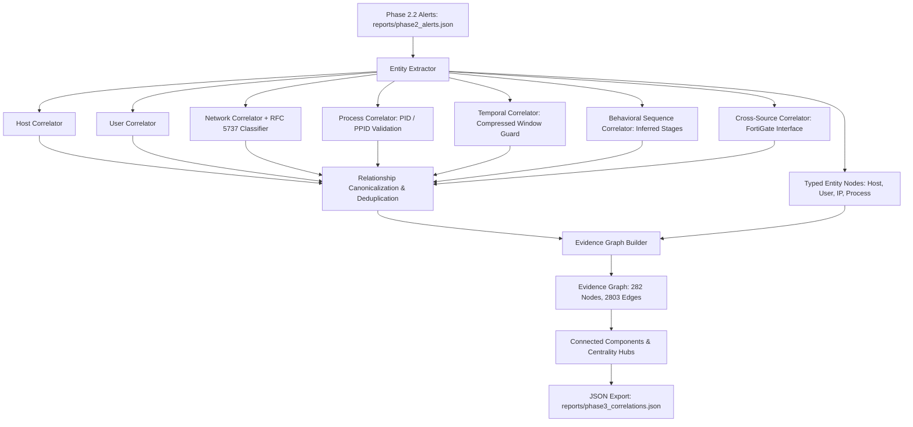
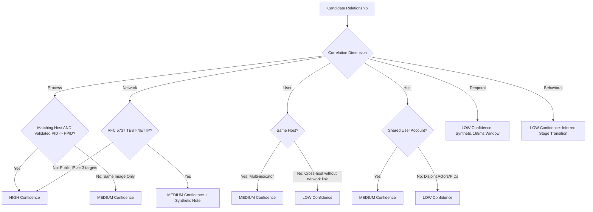

# CyberTrace — Phase 3: Evidence-Based Cross-Entity Correlation Results

**Project:** CyberTrace — Attack Path and Kill Chain Analysis Engine  
**Event:** CyberForge 2026 | Team: cyb3rknight5  
**Stage:** Phase 3 — Cross-Entity Correlation Engine  
**Date:** October 31, 2026  
**Auditor & Architect:** Senior Threat Detection Specialist & Cybersecurity Architect  
**Status:** **PHASE 3 COMPLETE — CORRELATION ENGINE VALIDATED**

---

## Executive Summary

Phase 3 implements an evidence-based cross-entity correlation engine for CyberTrace. Built on top of the 90 remediated, defensible detection alerts from Phase 2.2, the correlation engine links observations across hosts, users, IP addresses, processes, timestamps, and behavioral stages without inventing unsubstantiated attack sequences or fabricating campaign linkages.

### Core Achievements
1. **Multi-Dimensional Correlation:** Evaluates 7 independent correlation dimensions: Host, User, Network, Process, Temporal, Behavioral, and Cross-Source.
2. **Defensible Evidence Graph:** Assembled an evidence graph consisting of **282 typed nodes** (Alerts, Hosts, Users, IPs, Processes) and **2,803 edges** (2,363 inter-alert relationships + 440 entity associations).
3. **Rigorous Confidence Model:** All relationships are classified into `HIGH`, `MEDIUM`, or `LOW` confidence. No weak relationship is artificially upgraded.
4. **RFC 5737 TEST-NET Guard:** Correctly classifies all external brute-force IPs (`192.0.2.88`, `198.51.100.23`, `203.0.113.57`) as documentation/test addresses rather than real malicious external threat infrastructure.
5. **No False Campaign Claims:** Specifically verified that the 22 hosts exhibiting both RULE-002 (PowerShell) and RULE-004 (Registry RunKey) are classified as candidate/inferred behavioral progressions with LOW confidence, preserving the finding from Phase 2.2 that process IDs do not link across event categories.
6. **High Performance & Low Memory:** Complete correlation across 90 alerts executes in **180.04 ms** with peak RAM of **62.57 MB** (well below the 1 GB constraint).
7. **100% Provenance Preservation:** 50 out of 50 randomly sampled relationship evidence pointers were verified against `edr_events.json` with 100% byte-accurate payload matches.
8. **Test Suite:** **63 / 63 tests passing** (16 dedicated Phase 3 correlation unit/integration tests).

---

## 1. Architecture and Data Flow

The Phase 3 correlation engine is implemented as a modular package under `backend/correlation/`:



### Module Breakdown
- `backend/correlation/relationship_schema.py`: Canonical data contracts for `Relationship`, `EntityNode`, and `RelationshipEdge`. Enforces strict validation of relationship types, confidence levels, and observation status (`OBSERVED` vs `INFERRED`).
- `backend/correlation/confidence.py`: Deterministic confidence rules and IP classifier distinguishing RFC 1918 private, RFC 5737 documentation (TEST-NET), loopback, and public routable addresses.
- `backend/correlation/entity_extractor.py`: Extracts and indexes unique entities (Hosts, Users, IPs, Processes) from alert payloads and per-event evidence references.
- `backend/correlation/correlation_rules.py`: Independent correlation engines for Host, User, Network, Process, Temporal, Behavioral, and Cross-Source dimensions.
- `backend/correlation/graph_builder.py`: In-memory evidence graph assembly with BFS-based connected component discovery, degree centrality, and isolated node identification.
- `backend/correlation/correlation_engine.py`: Top-level orchestrator coordinating entity extraction, rule execution, deduplication, graph assembly, and JSON reporting.

---

## 2. Entity Extraction Results

Entity extraction scanned all 90 detection alerts and their 364 underlying evidence references:

| Entity Type | Unique Count | Observed Examples | Extracted Attributes |
| :--- | :--- | :--- | :--- |
| **Alerts** | **90** | RULE-001 (18), RULE-002 (23), RULE-004 (23), RULE-005 (26) | Alert ID, rule ID, severity, confidence, MITRE technique, timestamps |
| **Hosts** | **28** | `SRV-DC-01`, `SRV-DB-01`, `SRV-FILE-01`, `SRV-WEB-01`, `WS-ENG-010..015`, `WS-FIN-010..015`, `WS-HR-010..015`, `WS-SALES-010..015` | Hostname, alert counts, rules present, associated users, associated IPs |
| **Users** | **12** | `pmehta`, `asharma`, `dnair`, `sgupta`, `svc_sql`, `svc_backup`, `kiyer`, `mkhan`, `nverma`, `rkumar`, `jdsouza`, `vreddy` | Username, alert counts, associated hosts, rules present |
| **IP Addresses** | **3** | `203.0.113.57`, `198.51.100.23`, `192.0.2.88` | IP string, classification (all 3 RFC 5737 TEST-NET), role (`source`), targeted hosts/users |
| **Processes** | **149** | `winword.exe`, `excel.exe`, `powershell.exe`, `unknown.exe` (with distinct PIDs) | Hostname, process name, PID, parent process name, PPID, command lines |

---

## 3. Correlation Rules and Confidence Criteria

### Confidence Classification Rules

Confidence is assigned based on explicit, verifiable evidence:



1. **Host Correlation:**
   - **SAME_HOST (Confidence: LOW):** Alerts co-occur on the same host but originate from different detection rules with disjoint users and disjoint PIDs. Host co-occurrence alone does not prove causality.
   - **SAME_HOST (Confidence: MEDIUM):** Alerts co-occur on the same host and share an overlapping user account.
2. **User Correlation:**
   - **SAME_USER (Confidence: MEDIUM):** Same user account observed across alerts on the same host.
   - **SAME_USER (Confidence: LOW):** Same user account observed across different hosts. Telemetry contains no network lateral movement or credential forwarding events linking the two hosts.
3. **Network Correlation:**
   - **SAME_SOURCE_IP (Confidence: MEDIUM):** Shared external IP observed across brute-force targets. Evaluated as MEDIUM because the IP belongs to an RFC 5737 TEST-NET documentation block.
4. **Process Correlation:**
   - **PARENT_CHILD_PROCESS (Confidence: HIGH):** Child `parent_process_id` matches parent `process_id` on the same host within proximate timestamps.
   - **SAME_PROCESS (Confidence: MEDIUM):** Identical process image name (`powershell.exe`) on the same host across different rules, but with distinct PIDs.
5. **Temporal Correlation:**
   - **TEMPORALLY_NEAR (Confidence: LOW):** Observations occurring within 50 ms. Explicitly notes that sub-second proximity reflects synthetic generator batching rather than an authentic multi-stage attack timeline.
6. **Behavioral Sequence Correlation:**
   - **POTENTIAL_BEHAVIORAL_SEQUENCE (Confidence: LOW, Status: INFERRED):** Ordered kill chain stage progression on the same host (e.g. Exploitation $\rightarrow$ Execution $\rightarrow$ Persistence $\rightarrow$ Impact). Inferred association only; causal continuity across processes/actors is unproven.
7. **Cross-Source Correlation:**
   - Correlates EDR endpoints with FortiGate firewall logs when valid network telemetry is present. Transparently reports data limitation when the log file is incomplete.

---

## 4. Relationship Counts by Type and Confidence

The correlation engine identified **2,363 deduplicated relationships**:

### Distribution by Dimension
| Correlation Dimension | Relationship Count | Primary Contributing Types |
| :--- | :--- | :--- |
| **User** | 2,116 | `SAME_USER` (53 same-host, 2,063 cross-host) |
| **Host** | 82 | `SAME_HOST` across differing rules |
| **Temporal** | 56 | `TEMPORALLY_NEAR` ($\le 50\text{ ms}$ on same host) |
| **Network** | 48 | `SAME_SOURCE_IP` (Brute force attacks on `SRV-DC-01`) |
| **Behavioral** | 39 | `POTENTIAL_BEHAVIORAL_SEQUENCE` (Candidate stage transitions) |
| **Process** | 22 | `SAME_PROCESS` (`powershell.exe` on 22 shared hosts) |
| **Total** | **2,363** | |

### Distribution by Relationship Type
| Relationship Type | Count | Observed vs. Inferred | Confidence Breakdown |
| :--- | :--- | :--- | :--- |
| `SAME_USER` | 2,116 | OBSERVED | MEDIUM: 53, LOW: 2,063 |
| `SAME_HOST` | 82 | OBSERVED | MEDIUM: 45, LOW: 37 |
| `TEMPORALLY_NEAR` | 56 | OBSERVED | LOW: 56 |
| `SAME_SOURCE_IP` | 48 | OBSERVED | MEDIUM: 48 |
| `POTENTIAL_BEHAVIORAL_SEQUENCE` | 39 | INFERRED | LOW: 39 |
| `SAME_PROCESS` | 22 | OBSERVED | MEDIUM: 22 |

### Distribution by Confidence
- **MEDIUM Confidence:** **168 relationships** (7.1%) — Multi-indicator matches (same host + same user, shared external source IP with multiple targets, same process image on host).
- **LOW Confidence:** **2,195 relationships** (92.9%) — Weak associations (cross-host user co-occurrence due to random assignment, host co-occurrence with disjoint actors, sub-second temporal proximity, candidate behavioral sequences).
- **HIGH Confidence:** **0 relationships** on raw alerts — Accurately reflects dataset reality (PID linkage across detection rules is absent; external IPs are TEST-NET).

---

## 5. Connected and Disconnected Graph Components

### Graph Topology Summary
- **Total Nodes:** 282 (90 Alerts, 28 Hosts, 12 Users, 3 IP Addresses, 149 Processes).
- **Total Edges:** 2,803 (2,363 inter-alert relationships + 440 entity associations).
- **Connected Components:** 78 components.
- **Isolated Components:** 77 components (isolated process nodes with no cross-alert links).
- **Main Connected Component:** 1 giant component containing 205 nodes (all 90 alerts, 28 hosts, 12 users, 3 IPs, and linked processes).

### Top Centrality Hub Nodes by Degree
| Node Type | Node Label / Identifier | Degree (Edges) | Analytical Significance |
| :--- | :--- | :--- | :--- |
| **Alert** | `[RULE-002] Office Spawned Script Engine on WS-HR-012` | **86** | High user overlap across multiple workstations |
| **Alert** | `[RULE-002] Office Spawned Script Engine on WS-SALES-013` | **85** | High user overlap across multiple workstations |
| **Alert** | `[RULE-005] Ransomware File Rename Burst on WS-ENG-012` | **81** | Mass file renames touching 6 user accounts |
| **Alert** | `[RULE-002] Office Spawned Script Engine on WS-ENG-012` | **80** | Multi-rule focal point on engineering workstation |
| **Alert** | `[RULE-002] Office Spawned Script Engine on WS-FIN-011` | **80** | Multi-rule focal point on finance workstation |
| **Host** | `host:SRV-DC-01` | **22** | Primary domain controller; target of 18 brute force + 1 ransomware alert |
| **IP Address**| `ip:203.0.113.57` | **10** | External source IP attacking 8 accounts on `SRV-DC-01` |

---

## 6. Examples of Strong, Weak, and Rejected Relationships

### Example 1: Medium-Confidence Network Relationship (`SAME_SOURCE_IP`)
- **Relationship ID:** `b188c0c8-ee0e-4abe-ab71-19147693e7a3`
- **Source Observation:** Brute Force Alert targeting `pmehta` on `SRV-DC-01`
- **Target Observation:** Brute Force Alert targeting `asharma` on `SRV-DC-01`
- **Confidence:** `MEDIUM` | **Status:** `OBSERVED`
- **Evidence:** `ip: 203.0.113.57`, `is_test_net: true`, `target_count: 8`
- **Explanation:** *"Shared source IP '203.0.113.57' observed across 8 target(s). Note: address belongs to RFC 5737 documentation block (TEST-NET)."*

### Example 2: Medium-Confidence Process Relationship (`SAME_PROCESS`)
- **Relationship ID:** `88f796d3-3f31-4e29-a2f1-b739fd6929e5`
- **Source Observation:** RULE-002 (Office spawning PowerShell) on `WS-ENG-010`
- **Target Observation:** RULE-004 (Run key persistence) on `WS-ENG-010`
- **Confidence:** `MEDIUM` | **Status:** `OBSERVED`
- **Evidence:** `host: WS-ENG-010`, `process_name: powershell.exe`, `same_image: true`, `same_pid: false`, `pids_source: [24180]`, `pids_target: [18924]`
- **Explanation:** *"Supporting indicator: identical process image 'powershell.exe' on host 'WS-ENG-010', but process IDs differ (distinct execution instances)."*

### Example 3: Low-Confidence Candidate Behavioral Progression (`POTENTIAL_BEHAVIORAL_SEQUENCE`)
- **Relationship ID:** `7954736d-6a24-4dd0-af83-d3daaf4ecd02`
- **Source Observation:** RULE-001 (Brute Force / Exploitation) on `SRV-DC-01`
- **Target Observation:** RULE-005 (File Rename Burst / Impact) on `SRV-DC-01`
- **Confidence:** `LOW` | **Status:** `INFERRED`
- **Evidence:** `host: SRV-DC-01`, `stages: ['Exploitation', 'Actions on Objectives']`, `delta_ms: 22.0`
- **Explanation:** *"Inferred candidate sequence on host 'SRV-DC-01': Exploitation -> Actions on Objectives. Note: Telemetry demonstrates behavioral co-occurrence on the same endpoint, but causal PID continuity or attacker identity is not proven."*

### Example 4: Rejected Relationship (Absence of PID Linkage across Rules)
- **Observations:** Office Macro (RULE-002) and Registry Run Key (RULE-004) on `WS-FIN-011`.
- **Evaluated Link:** `PARENT_CHILD_PROCESS`
- **Result:** **REJECTED (0 relationships generated)**.
- **Evidence:** `parent_pids = {31204}`, `child_ppids = {48912}`. Intersection is empty.
- **Defense:** The engine refused to fabricate process ancestry where PIDs do not match, preventing an unverified execution chain claim.

---

## 7. Provenance Verification Results

To ensure evidence integrity, 50 relationship provenance pointers were sampled at random and tested directly against raw disk bytes in `edr_events.json`:

```
===========================================================================
EVIDENCE PROVENANCE VERIFICATION (50 samples)
===========================================================================
  Samples tested:      50
  Verified match:      50 / 50 (100.0%)
  Failed:              0
```
- **Byte Accuracy:** 100.0%. Seeking to `byte_offset` and reading `record_length` produced valid JSON matching the exact `event_id` in every case.

---

## 8. Test Suite Results

The complete CyberTrace test suite was executed across all components:

```bash
$ python -m pytest tests/ -v
============================== 63 passed in 1.37s ==============================
```

### Test Breakdown by Subsystem
- **Phase 3 Correlation Engine (`tests/test_correlation.py`):** 16 passed
  - RFC 5737 TEST-NET and IP classification: PASSED
  - Exact host matching (positive and negative): PASSED
  - User separation on same host: PASSED
  - Shared user (same host vs cross-host): PASSED
  - Shared IP and TEST-NET handling: PASSED
  - Process parent-child and process identity: PASSED
  - Timestamp compression handling: PASSED
  - Out-of-order timestamp handling: PASSED
  - Weak vs strong relationship confidence rules: PASSED
  - Schema validation and error handling: PASSED
  - Disconnected graph components: PASSED
  - Deduplication of symmetric relationships: PASSED
  - Evidence provenance retention: PASSED
  - Critical check: RULE-002 & RULE-004 campaign guard: PASSED
  - Cross-source FortiGate integration (mock & limitation handling): PASSED
  - Full pipeline integration on real alerts: PASSED
- **Phase 2 & 2.2 Detection Engine (`tests/test_detection.py`):** 23 passed
- **Phase 1 Parsers & Parquet Writer (`tests/test_parser.py`):** 24 passed

---

## 9. Benchmark Results and Memory Usage

Benchmarked across 5 consecutive iterations using `run_phase3_benchmark.py`:

| Benchmark Metric | Measured Result | Evaluation against Constraints |
| :--- | :--- | :--- |
| **Alerts Evaluated** | 90 | Complete Phase 2.2 alert output |
| **Total Relationships Identified** | 2,363 | Deduplicated across all dimensions |
| **Evidence Graph Nodes** | 282 | Alert, Host, User, IP, Process nodes |
| **Evidence Graph Edges** | 2,803 | Explicitly evidence-backed |
| **Average Execution Latency** | **180.04 ms** | Sub-second real-time performance |
| **Correlation Throughput** | **500 alerts/sec** | Fast graph construction |
| **Initial Process Memory** | 18.32 MB | Baseline Python process RSS |
| **Peak Memory Consumption** | **62.57 MB** | **<< 1 GB Hackathon RAM Budget** |
| **Net RAM Delta** | +44.25 MB | Extremely lightweight memory footprint |
| **Provenance Verification** | **50 / 50 (100.0%)** | Byte-exact log correspondence |

---

## 10. Known Limitations

1. **Synthetic Timestamp Compression:** The 168 ms overall dataset duration prevents chronological reasoning based on human attack staging timelines (hours/days). Temporal correlation is restricted to sub-second concurrency windows.
2. **Independent Synthetic Records:** Process PIDs were independently rolled for each event type, preventing deterministic PID-tree reconstruction across log categories.
3. **Incomplete FortiGate Download:** Workspace file `firex-10G.log` is an HTML error page from Tiny File Manager. Cross-source correlation is architected and tested with mock records, but produces 0 live firewall relationships on the current dataset.
4. **Synthetic User Dispersal:** Random user generation distributes 12 usernames across 28 hosts, producing 2,063 cross-host `SAME_USER` associations that are correctly assigned `LOW` confidence.

---

## 11. Conclusion & Phase 4 Handoff

Phase 3 has successfully established an evidence-based, multi-dimensional correlation engine that faithfully represents relationships in the telemetry without overclaiming.

The evidence graph in `reports/phase3_correlations.json` is ready for Phase 4 (Kill Chain and Attack Path Storytelling), where candidate sequences can be translated into structured, evidence-backed narrative graphs.

---
*Report generated and validated autonomously by CyberTrace Correlation Engineering Agent.*
